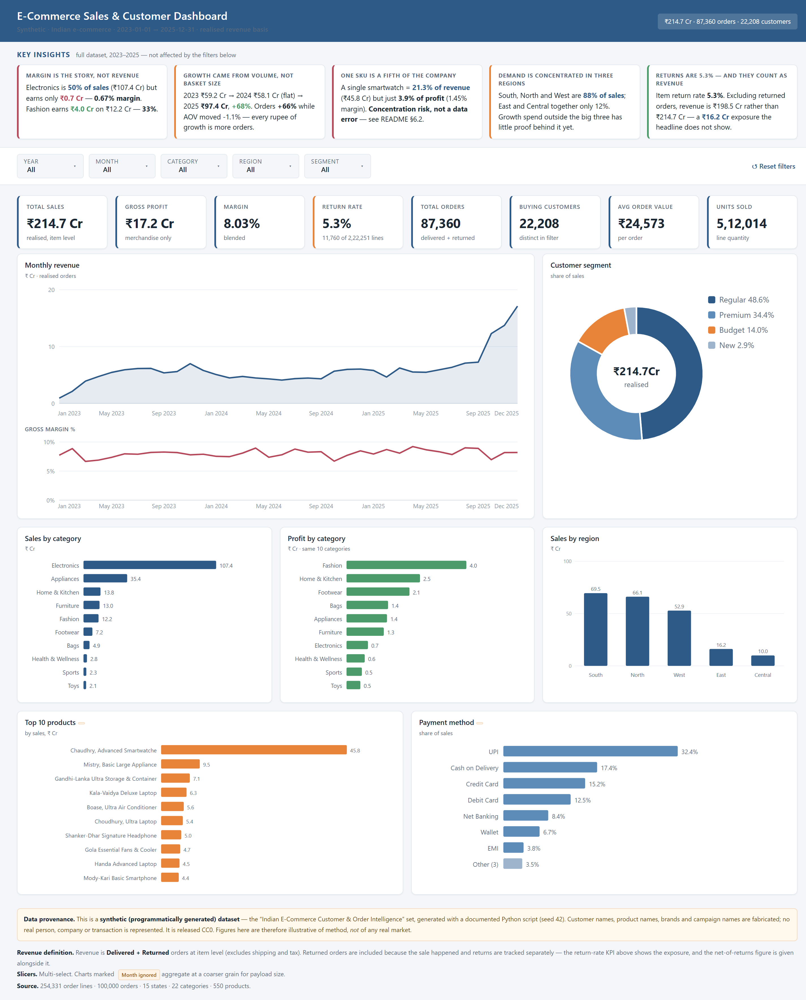

# E-Commerce Sales & Customer Analytics

End-to-end analytics project on a **synthetic Indian e-commerce marketplace**: 9 relational tables,
~559K rows, 3 years of transactions (2023-01-01 → 2025-12-31). Built with **SQL + Python + Excel-
ready exports**, and specified for **Power BI**.

> **Headline finding:** the business grew revenue 68% in 2025 while running an 8.03% gross margin —
> because the category generating half its revenue (Electronics) earns **0.67%** margin, and **34% of
> line items are discounted past the point where profit turns negative (20%)**.



> **Live version:** enable GitHub Pages on this repo (Settings → Pages → Deploy from branch `/root`)
> and `index.html` will serve the interactive dashboard at
> `https://<your-username>.github.io/ecommerce-sales-customer-analytics/`.

---

## 60-second tour

| Time | Where to look |
|---|---|
| 30 sec | The headline finding above and the dashboard screenshot |
| 2 min | [`dashboard/ecommerce_dashboard.html`](dashboard/ecommerce_dashboard.html) — interactive, working slicers, opens offline |
| 5 min | [§6 Key insights](#6-key-insights) — margin mix and the single-SKU concentration test |
| 10 min | [`reports/sql/postgres_results.md`](reports/sql/postgres_results.md) — real PostgreSQL output, not a screenshot |
| 20 min | [`python/ecommerce_eda.ipynb`](python/ecommerce_eda.ipynb) — executed notebook, 12 figures |
| 30 min | [`reports/KPI_DEFINITIONS.md`](reports/KPI_DEFINITIONS.md) — how every metric is defined and why |

---

## Key insights

| # | Finding | The number |
|---|---|---|
| 1 | **Margin is the story, not revenue.** Electronics is half of sales and a rounding error of profit; Fashion is the mirror image. | Electronics: **₹107.4 Cr** sales → **₹0.7 Cr** profit (**0.67%**). Fashion: **₹12.2 Cr** → **₹4.0 Cr** (**33.2%**) |
| 2 | **Growth came from volume, not basket size.** | 2023 ₹59.2 Cr → 2024 ₹58.1 Cr (flat) → 2025 **₹97.4 Cr (+68%)**; orders **+66%**, AOV **−1.1%** |
| 3 | **One SKU is a fifth of the company — genuine concentration, not a data error.** | ₹45.8 Cr = **21.35%** of revenue at **1.45%** margin = 3.9% of profit (evidence in §6.2) |
| 4 | **Demand is concentrated in three regions.** | South + North + West = **88%**; East + Central = **12%** |
| 5 | **Returns are 5.3% and are counted in revenue.** | Item return rate **5.3%**; net of returned orders revenue is ₹198.5 Cr, a **₹16.2 Cr** exposure |
| 6 | **Discounting destroys value past 20%.** | Margin turns negative at **20%**; **34.1%** of lines sit there, losing **₹4.9 Cr** |

---

## 1. Business problem

The company can report how much it sold. It cannot answer **which sales are worth making**. Revenue and
profit point in different directions, and no single definition of "revenue" had been agreed.

**Objective:** establish one governed definition of revenue and profit, then identify where to defend
margin, where to invest, and what to stop doing.

**Stakeholders:** Commercial director (category mix, pricing), Head of Marketing (channel and discount
policy), Operations (delivery performance).

## 2. Business questions answered

| # | Question | Where |
|---|---|---|
| 1 | What is total revenue and profit? | `sql/02` Q1–Q3 · notebook §2 |
| 2 | Which products generate the most revenue? | `sql/02` Q8 · notebook §5 |
| 3 | Which categories have the highest margin? | `sql/02` Q9–Q10 · notebook §5 |
| 4 | Which regions perform best? | `sql/02` Q11–Q12 · notebook §7 |
| 5 | What are the monthly / quarterly trends? | `sql/02` Q4–Q5 · notebook §3 |
| 6 | Who are the highest-value customers? | `sql/03` Q2–Q4 · notebook §8 |
| 7 | Which customers are repeat vs one-time? | `sql/03` Q1, Q5, Q10 · notebook §8 |
| 8 | What should management focus on? | notebook §11 |
| 9 | Are there seasonal patterns? | `sql/02` Q6–Q7 · notebook §4 |

## 3. Dataset — read this first: the data is synthetic

> **This is a 100% synthetic, programmatically generated dataset.** It is the
> “Indian E-Commerce Customer & Order Intelligence” set, produced by a single documented Python
> script (`generate_dataset.py`, seed 42) that ships with the data. **Customer names, product names,
> brands, campaign names and every identifier are fabricated.** No real person, company, address or
> transaction is represented; Indian state and city names are used only for geographic realism.
> It is released under CC0.
>
> **What that means for you as a reader:** the *method* here is real — definitions, reconciliation,
> SQL, modelling, dashboard — but the *effect sizes are not evidence about any real market*. Treat
> the findings as a demonstration of how to find this kind of thing, not as facts about Indian
> e-commerce. If a name like “Chaudhry, Advanced Smartwatche” looks invented, that is because it is.

| Table | Rows | Grain |
|---|---:|---|
| customers | 25,000 | 1 / customer |
| products | 550 | 1 / product |
| orders | 100,000 | 1 / order |
| order_items | 254,331 | 1 / line item |
| payments | 100,000 | 1 / order |
| shipments | 89,681 | 1 / shipped order |
| returns | 12,075 | 1 / returned item |
| customer_reviews | 77,530 | 1 / review |
| marketing_campaigns | 151 | 1 / campaign |

The nine source CSVs, the generator script, the data dictionary and the data-quality audit all ship
in [`data/source/`](data/source/) — the project is self-contained and can be rebuilt from scratch.

## 4. Tools & technologies

| Tool | Used for |
|---|---|
| **PostgreSQL 16** | Production schema (constraints, FKs, indexes), governed views, 10 analysis queries — `sql/postgres/` |
| **SQL** (SQLite) | Same analysis runnable with no install; 43 executed statements, results in `reports/sql/` |
| **Python** (pandas, matplotlib, seaborn) | EDA, RFM, cohort analysis, 12 charts |
| **Excel / CSV** | Power BI-ready star schema + denormalised fact exports |
| **Power BI** | Dashboard spec, 40+ DAX measures, build guide |

An **interactive HTML dashboard** (`dashboard/ecommerce_dashboard.html`) ships with the project and
runs offline in any browser — working Year / Month / Category / Region / Segment slicers, real
filtering against the full dataset (3.3 MB, all data embedded, no CDN or server needed).

## 5. Data cleaning — the decisions that matter

Structural cleaning was **not** required: 0 duplicate keys, 0 orphan foreign keys, 0 duplicate rows,
and `orders.subtotal` reconciles to `SUM(order_items.item_revenue)` with **max diff 0.00** across all
100,000 orders.

What *did* require decisions were five semantic traps, all resolved in `sql/01_data_cleaning.sql`:

| # | Issue found | Decision |
|---|---|---|
| 1 | Three legitimate revenue definitions differ by **₹303 M** | Revenue = realised (`Delivered + Returned`), item level |
| 2 | `customers.total_spend` excludes `Failed` orders (₹71.8 Cr) | Never mix with `orders.final_amount` |
| 3 | 409 return rows sit on `Cancelled`/`Failed` orders that never shipped | Excluded from all return metrics |
| 4 | `orders.discount_percentage` is **not** applied to `final_amount` | Carried as descriptive only — applying it double-counts |
| 5 | `payments.amount_paid` = 0 for 7,173 Failed/Not-Charged/Pending orders | Revenue measured from `order_items` only |

## 6. Key insights

### 6.1 Revenue and margin are pulled apart by two categories

| Category | Revenue share | Gross margin | Profit share |
|---|---:|---:|---:|
| Electronics | **50.0%** | **0.67%** | 4.2% |
| Appliances | 16.5% | 3.86% | 7.9% |
| Home & Kitchen | 6.4% | 18.0% | 14.4% |
| Fashion | 5.7% | **33.2%** | **23.5%** |
| Footwear | 3.4% | 29.4% | 12.3% |

Fashion, Footwear, Bags and Home & Kitchen are **17.7% of revenue but 58% of gross profit**.
Electronics is half the revenue and one-twentieth of the profit.

### 6.2 One SKU is 21% of the company — concentration risk, not a data error

`PROD10246` (premium smartwatch, ₹66,050 list) generates **₹45.8 Cr — 21.35% of total revenue — at a
1.45% margin**. It is **3.9% of profit**. Because it is the first thing a reviewer will suspect, I
tested it as a possible data defect rather than assuming either way:

| Test | Result | Verdict |
|---|---|---|
| Unit price consistency | 3,414 lines, **1** distinct unit price, all equal `products.price` | clean |
| Quantity per line | SKU 2.33 vs catalogue 2.30 | normal |
| Discount depth | SKU 13.0% vs catalogue median 12.9% | normal |
| Cost ratio (cost ÷ price) | 0.858 — **92nd percentile** of 550 products (p90 = 0.845) | high but in-range |
| Unit volume rank | **10th** of 550 — it is *not* the highest-volume product | normal |
| Price rank | **4th** of 550 | high |
| Revenue gap to #2 | 4.8× (₹45.8 Cr vs ₹9.5 Cr) | extreme |

**Conclusion: this is legitimate concentration, not a corrupted row.** No duplicate, no price
inconsistency, no impossible quantity. It is the multiplicative result of a near-top price (4th of
550) and a near-top volume (10th of 550) on a product whose cost is 85.8% of list.

**Why it matters commercially.** The exposure is *asymmetric*: a stock-out, quality event or
delisting on this SKU moves 21% of the top line while barely touching profit. And because its margin
is already 1.45%, there is no pricing lever left — cutting price cannot be absorbed, and the discount
already applied (~13%) is most of the margin. The risk is supply and returns, not price.

Whole-catalogue context: **13 products (2.4%) = 50% of revenue**; 53 (9.6%) = 80%.

### 6.3 Discounting crosses into value destruction at 20%

| Discount band | Revenue share | Gross margin |
|---|---:|---:|
| 0% | 21.7% | +19.85% |
| 1–10% | 33.0% | +15.40% |
| 10–20% | 22.8% | +4.10% |
| **20–25%** | 10.0% | **−5.25%** |
| **25%+** | 12.5% | **−14.23%** |

**34.1% of line items are at ≥20% discount**, losing ₹4.9 Cr of gross profit. At an 8% blended margin
there is no volume case that repays a 20% price cut without evidence — and this dataset contains no
price experiment, so it must be tested, not assumed.

### 6.4 Demand is seasonal and Q4-concentrated

Q4 is **36.9%** of three-year revenue; Q4-2025 alone is **20.1%**. December generates **2.46×** the
revenue per trading day of January. Inventory and cash planning must be built around Oct–Dec.

### 6.5 Customers are loyal but thinly retained

- **80.2%** of buying customers are repeat customers, and they carry **95.6%** of revenue.
- **14.5%** of customers (3,212) generate 50% of revenue.
- But cohort activity decays hard: **31.5%** buy again in month 2, only **6.8%** by month 12.
- RFM: Champions + Loyal = 25.8% of customers, 46.2% of revenue. At Risk + Cannot Lose hold ₹66 Cr.

The opportunity is **re-activation of a long tail**, not defending a retained core.

### 6.6 Operations: 42.8% of deliveries are late

Delay rate is 42–44% in *every* region, so it is a company-wide process problem, not a geographic one.
The cheap tier is worst: **Standard = 54.9% late**, Same-Day 57.6%, Next-Day 10.6%.

### 6.7 ₹261 M of demand never converted

Cancelled + Failed orders = 10,953 orders / **₹261.4 M — 10.7% of total demand**.

## 7. Recommendations

| Priority | Action | Basis |
|---|---|---|
| 1 | **Cap discounts at 15%** and A/B test on a product subset | 34.1% of lines sit past the 20% breakeven; ~₹7 Cr recoverable before volume effects |
| 2 | **Fix premium-electronics economics** — renegotiate cost, stop discounting thin-margin SKUs, or shift mix | 50% of revenue at 0.67% margin |
| 3 | **Shift investment to Fashion / Footwear / Bags / Home & Kitchen** | 17.7% of revenue, 58% of profit |
| 4 | **Treat the top 13 SKUs as critical infrastructure** | 2.4% of products = 50% of revenue |
| 5 | **Cut delivery delay**, starting with the Standard tier | 42.8% overall, 54.9% on Standard |
| 6 | **Run re-activation, not retention** | 4,399 one-and-done buyers; month-12 activity 6.8% |

## 8. Project structure

```
ecommerce-sales-customer-analytics/
│
├── data/
│   ├── source/                # the nine raw CSVs + generator + data dictionary + audit
│   ├── raw_data.csv           # GENERATED · 254,331 × 64  untouched join
│   ├── cleaned_data.csv       # GENERATED · 254,331 × 83  analysis-ready
│   └── powerbi/               # star schema for Power BI import
│       ├── fact_sales.csv     # GENERATED · 254,331 rows
│       ├── fact_returns.csv
│       ├── dim_date.csv
│       ├── dim_customers.csv
│       ├── dim_products.csv
│       └── dim_campaigns.csv
│
├── sql/
│   ├── postgres/                  # ★ real PostgreSQL — schema, COPY load, executed queries
│   │   ├── 01_schema.sql          # DDL: 8 tables, 9 FKs, CHECKs, 13 indexes, 2 views, gate
│   │   ├── 02_analysis.sql        # 10 queries: CTEs, window functions, RFM, cohorts
│   │   ├── load.py                # COPY loader + gate + query runner
│   │   └── README.md              # query inventory and design rationale
│   ├── 01_data_cleaning.sql       # SQLite mirror: views + governing definitions + gate
│   ├── 02_sales_analysis.sql      # 20 queries: revenue, product, category, region, trend
│   └── 03_customer_analysis.sql   # 13 queries: RFM, repeat, cohort, churn, cadence
│
├── python/
│   ├── ecommerce_eda.ipynb        # executed notebook, 15 code cells, 12 figures
│   ├── build_pipeline.py          # rebuilds data/ exports + db/ecommerce.db from the raw drop
│   ├── run_sql.py                 # executes sql/*.sql -> reports/sql/*.md
│   ├── build_notebook.py          # regenerates the notebook source
│   └── build_dashboard.py         # regenerates dashboard assets + HTML
│
├── dashboard/
│   ├── ecommerce_dashboard.html   # INTERACTIVE dashboard — working slicers, opens offline
│   ├── dax_measures.dax           # 40+ measures, grouped by display folder
│   └── POWERBI_BUILD_GUIDE.md     # step-by-step .pbix build + verification values
│
├── db/
│   └── ecommerce.db               # GENERATED · SQLite warehouse the SQL files run against
│
├── reports/
│   ├── KPI_DEFINITIONS.md         # every metric's formula and defining decision
│   ├── sql/                       # executed SQL output, rendered as markdown
│   │   ├── postgres_results.md    # ← 10 PostgreSQL queries, real output
│   │   ├── 01_data_cleaning.md
│   │   ├── 02_sales_analysis.md
│   │   └── 03_customer_analysis.md
│   └── figures/                   # 12 chart PNGs
│
├── screenshots/
│   └── dashboard.png
│
├── index.html                     # GitHub Pages redirect to the live dashboard
├── README.md
├── LICENSE                        # MIT (code) · CC0 (data)
└── requirements.txt
```

> **Files marked GENERATED are not committed.** `raw_data.csv` (126 MB) and `cleaned_data.csv`
> (153 MB) exceed GitHub's 100 MB per-file limit; `ecommerce.db` (59 MB) and `fact_sales.csv`
> (54 MB) are excluded to keep the clone light. One command rebuilds all four from
> `data/source/` — see [How to run](#9-how-to-run). The interactive dashboard is unaffected
> because it embeds the data it needs.

## 9. How to run

Requires Python 3.10+. Commands are run from the repository root.

```bash
# 1. install
pip install -r requirements.txt

# 2. rebuild the SQLite warehouse + CSV exports from data/source/  (~1–2 min)
python python/build_pipeline.py

# 3. run the analysis in PostgreSQL (creates schema, COPYs 559k rows, runs 10 queries)
export PGPASSWORD='your-postgres-password'
createdb -h localhost -p 5432 -U postgres ecommerce
python sql/postgres/load.py            # -> reports/sql/postgres_results.md

# 4. (optional) the SQLite mirror — no database install needed
python python/run_sql.py               # -> reports/sql/0*.md

# 5. execute the notebook
jupyter nbconvert --to notebook --execute --inplace python/ecommerce_eda.ipynb

# 6. dashboard
#    - open dashboard/ecommerce_dashboard.html in a browser, or
#    - follow dashboard/POWERBI_BUILD_GUIDE.md to build the .pbix
```

### On the Power BI / Tableau file

**Neither `.pbix` nor `.twb` is in this repo, and that is a deliberate disclosure, not an oversight.**
Both are binary/XML containers produced by their desktop applications; they cannot be generated
reliably outside Power BI Desktop or Tableau Desktop, and shipping a hand-written one that fails to
open is worse than shipping none.

What *is* here is everything those tools need, plus a working dashboard you can open right now:

| Artefact | Status |
|---|---|
| `data/powerbi/*.csv` — star schema at importable grain | ✅ ready to import |
| `dashboard/dax_measures.dax` — 40+ measures by display folder | ✅ copy-paste into Power BI |
| `dashboard/POWERBI_BUILD_GUIDE.md` — 9 steps + the exact values to verify after wiring | ✅ verified against the data |
| `dashboard/ecommerce_dashboard.html` — interactive, working slicers | ✅ open in any browser |
| `*.pbix` / `*.twb` | ❌ requires the desktop app |

If you want the native file, the build guide is 20–30 minutes of clicking and the verification
table at the end tells you immediately whether the model is right.

## 10. Verification

Every headline number is reproducible three ways — the PostgreSQL views, pandas on the CSV export,
and the dashboard cube:

| Metric | Value | PostgreSQL | pandas | dashboard |
|---|---:|---|---|---|
| Realised revenue | ₹2,146,672,724.50 | ✅ Q1 | ✅ | ✅ |
| Gross profit | ₹172,348,561.12 | ✅ Q1 | ✅ | ✅ |
| Blended margin | 8.03% | ✅ Q1 | ✅ | ✅ |
| Realised orders | 87,360 | ✅ Q1 | ✅ | ✅ |
| Buying customers | 22,208 | ✅ Q1 | ✅ | ✅ |
| Average order value | ₹24,572.72 | ✅ Q1 | ✅ | ✅ |
| Lost revenue | ₹261,358,233.50 | ✅ Q1 | ✅ | — |
| Return rate | 5.29% | ✅ Q1 | ✅ | ✅ |
| Electronics share / margin | 50.04% / 0.67% | ✅ Q3 | ✅ | ✅ |
| Largest SKU share | 21.35% | ✅ Q4 | ✅ | ✅ |
| 20%+ discount lines | 34.06% | ✅ Q9 | ✅ | — |

`sql/postgres/load.py` prints a 6-row integrity gate after loading and fails loudly if the views drift;
`sql/01_data_cleaning.sql` ends with the same gate for the SQLite mirror.

## 11. Limitations

- **Synthetic data.** Relationships are simulated; effect sizes are indicative, not causal.
- Revenue is merchandise-only (excludes shipping and tax), so it understates cash collected.
- Recency and churn are measured to a fixed 2025-12-31 cutoff.
- Discount → volume elasticity **cannot** be estimated: no pre/post price experiment exists in the data.
- No per-customer marketing cost, so customer-level CAC and true CLV are not derivable.
- 2,300 customers never purchased and are excluded from all buying-customer metrics.

## 12. Future improvements

1. **Price-elasticity test** — holdout cells by category to replace the directional discount
   recommendation with a measured one.
2. **Delivery-delay model** — `shipments.delayed_flag` is a clean label (see the anti-leakage note in
   the source README: exclude `actual_delivery_date` and `delivery_days` from features).
3. **Churn model** — build features only from orders before an "as of" date, predict `customer_status`
   after it. `customer_status` is derived from `last_order_date`, so naive use leaks the label.
4. **CLV with margin weighting** — rank customers on gross profit, not revenue; Electronics-heavy
   customers look far more valuable than they are.
5. **Warehouse migration** — the SQL is ANSI-shaped and runs on BigQuery/Snowflake with date-function
   edits only.

---

**Author:** Rakesh Mythreya Vulli · Data Analyst
This is an end-to-end portfolio project: business framing → data audit → governed metric definitions →
SQL → Python EDA → dashboard → decision-ready recommendations. Code is MIT-licensed; the synthetic
dataset is CC0.
